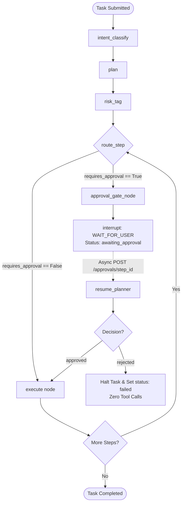

# D31 Spec: Approval-Gate Bypass Adversarial Test Suite & Agent-Loop End-to-End Suite

**Task (Manual §14, §15.4, D31, Suraj):** Approval-gate bypass adversarial test (must never pass) + agent-loop e2e test.  
**Date:** Mon 28 Sep 2026 · **Owner:** Suraj (Backend, Orchestration & Release Lead) · **Source:** Manual v2.0 (§4, §5.1, §8.1, §8.2, §9, §9.1–§9.4, §10, §14, §15, §15.4, §17 Gate 4, §18 A1, A2, A6, A9, §19).  
**Depends on:** D13 (LangGraph skeleton), D14 (Execute node & Calendar MCP), D15 (Gmail MCP & Resend send), D16 (GitHub & Slack MCP), D17 (Approval gate fail-closed logic & checkpointer), D29 (MCP integration test suite), D30 (Trust Dashboard metrics endpoint & Week-5 PR merge).  
**Cross-Team Support (Manual §14):**
- Ishani (Mobile Lead): Support e2e test from UI side (approval-gate bypass & modal rendering).
- Jigyasu: Support e2e test — voice-input-to-task-completion flow.
- Sanskriti: Support e2e testing — Settings/Memory flows.
- Shivangi: Support e2e testing — Digest / Manual-To-Do flows.
**Status:** Ready for Implementation (Offline mock-only test harness, deterministic fixtures, zero live secrets).

---

## 1. Objective

Deliver the two most safety-critical backend verification suites of AgentOps Copilot as scheduled for Day 31:

1. **Approval-Gate Adversarial Bypass Test Suite (`test_approval_gate_bypass_attempt_always_fails`):**  
   Implement an unyielding adversarial test battery that attempts to bypass the approval gate through every imaginable vector: missing `risk_rules` entries, direct execution node calls, replay attacks, IDOR cross-tenant approval tampering, spoofed/poisoned plan JSON payloads, and corrupted graph state. Per Manual §9.4, §15.4, and Acceptance Criterion **A2**, every action tagged high-risk must be blocked pending explicit human approval in **100% of test runs — zero tolerance**. A single failure in this suite is a non-negotiable hard blocker for Gate 4 release candidate certification.

2. **Agent-Loop End-to-End Test Suite (`test_agent_e2e.py`):**  
   Implement a comprehensive, deterministic end-to-end integration suite exercising the complete LangGraph agent loop from ingestion to final completion:OK
   - Text input full loop (`POST /tasks` -> planner -> execution -> logs -> completion).
   - Voice input full loop (`transcription_text` ingestion -> planning -> auto-execute -> completion).
   - Low-risk auto-execution without user interruption.
   - High-risk blocking with asynchronous human approval resumption.
   - High-risk user rejection halting the pipeline with zero tool-side-effects.
   - Mixed-risk multi-step topological execution order (low-risk steps run; high-risk halts).
   - Simulated process restart / disconnect mid-approval with state recovery from the checkpointer.

---

## 2. Architectural Invariants & Safety Guarantees

Section 9 of the Technical Implementation Manual dictates the core safety invariants that this test suite defends:

```
+--------------------------------------------------------------------------------------------------+
|                                    INVARIANT 1 (Fail-Closed)                                     |
|  Any action or tool not explicitly present in the seed `risk_rules` table with                    |
|  `requires_approval=False` MUST be treated as `requires_approval=True` and `risk_tier="high"`.    |
+--------------------------------------------------------------------------------------------------+
                                                 |
                                                 v
+--------------------------------------------------------------------------------------------------+
|                                    INVARIANT 2 (Zero LLM)                                        |
|  NO LLM prompt, model completion, or heuristic inference may EVER decide or alter whether        |
|  a step requires approval. Risk evaluation is a pure, deterministic database table read.         |
+--------------------------------------------------------------------------------------------------+
                                                 |
                                                 v
+--------------------------------------------------------------------------------------------------+
|                                  INVARIANT 3 (Graph Halting)                                     |
|  When `requires_approval=True`, `approval_gate_node` MUST interrupt the graph (`WAIT_FOR_USER`). |
|  `execute()` can NEVER be entered for that step without an explicit row in `approvals`           |
|  bearing `decision="approved"` created by the authenticated owner.                                |
+--------------------------------------------------------------------------------------------------+
                                                 |
                                                 v
+--------------------------------------------------------------------------------------------------+
|                                 INVARIANT 4 (Zero Side-Effects)                                  |
|  If an approval is rejected or unapproved, `call_tool()` MUST NEVER be dispatched.               |
|  No external side-effect (email, Slack post, calendar deletion) may occur.                       |
+--------------------------------------------------------------------------------------------------+
```

### 2.1 The LangGraph Routing State Machine

The conditional routing in `backend/app/agents/nodes.py` (`route_step`) governs the graph flow:



---

## 3. Adversarial Attack Matrix (Bypass Scenarios)

The adversarial bypass suite (`test_approval_gate_bypass_attempt_always_fails`) systematically executes seven specific adversarial attack vectors against the safety subsystem:

| Vector ID | Adversarial Scenario | Attack Description | Expected Defense & Assertion |
|---|---|---|---|
| **ADV-1** | **Missing Rule Lookup (Fail-Closed)** | Planner generates a step with an unknown tool (e.g., `system.wipe_disk`, `crypto.transfer_funds`, or `unknown_provider.action`). | `approval_gate.evaluate()` returns `risk_tier="high"`, `requires_approval=True`, `rationale` contains `"fail closed"`. Step enters `awaiting_approval`; cannot auto-execute. |
| **ADV-2** | **Cross-User Approval Hijack (IDOR)** | Attacker (User B) attempts to call `POST /approvals/{step_id}` with their own valid JWT to approve a high-risk step belonging to Victim (User A). | Endpoint returns `404 Not Found` (or `403 Forbidden`). Database query filters on `user_id == CurrentUser.id`. Graph for User A remains interrupted; task does NOT resume. |
| **ADV-3** | **Replay / Double-Decision Attack** | An attacker or buggy client submits `POST /approvals/{step_id}` twice for an already decided step (`decision="approved"` or `"rejected"`). | Second call returns `409 Conflict` with `"Approval already decided"`. The executor is NOT triggered a second time, preventing duplicate execution. |
| **ADV-4** | **Direct Execute Node Invocation (State Tampering)** | Attacker attempts to manually call the `execute` node function directly with an `AgentState` containing a high-risk step whose `requires_approval=True` and no approval decision exists. | Defensive guard inside `execute()` or routing layer validates approval status, rejecting execution or asserting that unapproved high-risk steps abort with error. |
| **ADV-5** | **Tampered Risk Flags in State** | A poisoned task state payload enters the graph where `risk_flags[0]` is manually overwritten to `{"requires_approval": False, "risk_tier": "low"}` for `gmail.send_message`. | The `risk_tag` node recomputes the risk flags deterministically from `risk_rules` table, overwriting any poisoned client-supplied values. |
| **ADV-6** | **Unauthenticated Decision Injection** | Request to `POST /approvals/{step_id}` without `Authorization: Bearer <token>` or with a malformed/expired JWT. | Fast rejection at FastAPI dependency layer with HTTP `401 Unauthorized`. Zero database modifications. |
| **ADV-7** | **Rejected Decision Enforcement** | User explicitly submits `{"decision": "rejected"}`. | `approvals.decision` set to `"rejected"`, `tasks.status` updated to `"failed"`, event `step_skipped` logged. `call_tool()` mock verifies `call_count == 0`. |

---

## 4. End-to-End Agent-Loop Scenarios

The `test_agent_e2e.py` suite tests the full lifecycle across both standard and edge operating conditions:

### 4.1 Scenario A: Low-Risk Task Full Loop (`test_e2e_text_task_completes_full_loop`)
- **Input:** Text prompt: `"Check my calendar for meetings tomorrow"`.
- **Flow:**
  1. `POST /tasks` returns `201 Created` with `status="submitted"`.
  2. Background runner executes `intent_classify` -> `plan` -> `risk_tag`.
  3. Step is `calendar.list_events` (Low risk, `requires_approval=False`).
  4. Node `execute()` invokes MCP tool call via `call_tool`.
  5. Monotonic latency measured; `execution_logs` records all phases.
  6. Final `tasks.status` updated to `"completed"`.
- **Validation:** 
  - `tasks.status == "completed"`
  - `plan_steps[0].status == "done"`
  - Zero `approvals` rows created.
  - Full audit trail in `execution_logs` (`intent_classified`, `plan_generated`, `risk_tagged`, `step_started`, `step_completed`).

### 4.2 Scenario B: High-Risk Task Approval Loop
- **Input:** Text prompt: `"Send an email to team@company.com with subject Meeting Notes"`.
- **Flow:**
  1. `POST /tasks` -> `plan` generates `gmail.send_message` (High risk, `requires_approval=True`).
  2. `risk_tag` logs `risk_tagged` and persists `plan_steps` with `risk_tier="high"`, `requires_approval=True`.
  3. `approval_gate_node` calls `gate()`:
     - Creates `approvals` row with `step_id`, `user_id`.
     - Updates `tasks.status = "awaiting_approval"`.
     - Updates `plan_steps.status = "awaiting_approval"`.
     - Raises `interrupt("WAIT_FOR_USER")`.
  4. Execution halts. MCP `call_tool` has NOT been called (`call_count == 0`).
  5. User queries `GET /approvals/pending` -> sees pending step.
  6. User calls `POST /approvals/{step_id}` with `{"decision": "approved"}`:
     - Updates `approvals.decision = "approved"`, calculates `response_time_ms`.
     - Invokes `resume_planner(task_id, "approved")`.
  7. Graph resumes at `approval_gate_node` -> routes to `execute` -> calls `call_tool` -> completes.
  8. Final `tasks.status == "completed"`, `plan_steps.status == "done"`.

### 4.3 Scenario C: Voice Input Full Loop (`test_e2e_voice_task_completes_full_loop`)
- **Input:** `POST /tasks` with `input_type="voice"`, `raw_input="audio_file_uuid.wav"`, `transcription_text="List my open github issues"`.
- **Flow:**
  1. `_fetch_raw_input()` correctly prioritizes `transcription_text` over `raw_input`.
  2. Intent correctly classified as `file_issue` or `list_issues`.
  3. Plan generated, risk tagged as low/medium.
  4. Execution runs, outputs persisted, task completed.

### 4.4 Scenario D: Mixed-Risk Multi-Step Plan (`test_mixed_risk_multi_step_plan_orders_correctly`)
- **Plan Structure:**
  - Step 0: `calendar.list_events` (Low risk, auto-execute).
  - Step 1: `gmail.send_message` (High risk, requires approval).
  - Step 2: `github.create_issue` (Medium risk, auto-execute).
- **Execution Progression:**
  1. Step 0 auto-executes immediately -> `plan_steps[0].status == "done"`.
  2. Graph advances to Step 1 -> halts at `approval_gate_node` -> `tasks.status == "awaiting_approval"`.
  3. Assert Step 2 has NOT executed (`plan_steps[2].status == "pending"`).
  4. User approves Step 1 -> Step 1 executes -> Step 2 executes -> `tasks.status == "completed"`.

### 4.5 Scenario E: Checkpoint Survival Across App Restart (`test_task_resumes_after_app_closed_mid_approval`)
- **Simulation:**
  1. Task halts in `approval_gate_node` with active Postgres checkpointer thread `thread_id=task_id`.
  2. The in-memory process state is discarded (simulating server crash, app closing, or container restart).
  3. A new runner/graph instance connects to the checkpointer.
  4. `resume_planner(task_id, "approved")` is called against the checkpointer thread.
  5. State is restored seamlessly; execution picks up exactly at the paused node and runs to completion.

---

## 5. Test Suite Matrix — 8 Named Tests (Manual §15.4)

All 8 tests specified in Section 15.4 of the Technical Implementation Manual are mapped across `backend/app/tests/test_approval_gate.py` and `backend/app/tests/test_agent_e2e.py`:

| # | Named Test (Manual §15.4) | Target Test File | Scope & Behavioral Contract |
|---|---|---|---|
| 1 | `test_low_risk_action_auto_executes_without_approval` | `test_approval_gate.py` & `test_agent_e2e.py` | Asserts `calendar.list_events`, `gmail.create_draft`, or `github.list_issues` evaluate to `requires_approval=False` and execute straight to completion without creating approval rows. |
| 2 | `test_high_risk_action_blocks_pending_approval` | `test_approval_gate.py` & `test_agent_e2e.py` | Asserts `gmail.send_message`, `slack.post_message_channel`, and `calendar.delete_event` evaluate to `requires_approval=True`, create approval row, update task status to `awaiting_approval`, and halt. |
| 3 | `test_approval_gate_bypass_attempt_always_fails` | `test_approval_gate.py` | Executes the 7-scenario adversarial bypass battery (ADV-1 to ADV-7). Asserts 100% fail-closed rate under invalid rules, IDOR, replay, and malformed state. Zero tool calls dispatched. |
| 4 | `test_rejected_approval_halts_task_with_no_side_effects` | `test_approval_gate.py` & `test_agent_e2e.py` | Asserts that submitting `decision="rejected"` sets `tasks.status="failed"`, logs `step_skipped`, and guarantees `call_tool()` is called zero times for the high-risk step. |
| 5 | `test_mixed_risk_multi_step_plan_orders_correctly` | `test_agent_e2e.py` | Asserts topological step execution: Step 0 (low) finishes -> Step 1 (high) halts -> subsequent steps wait -> upon approval, Step 1 and Step 2 finish. |
| 6 | `test_task_resumes_after_app_closed_mid_approval` | `test_approval_gate.py` & `test_agent_e2e.py` | Simulates process kill during `WAIT_FOR_USER`. Resumes graph via checkpointer thread ID; asserts state restoration and successful step execution. |
| 7 | `test_e2e_text_task_completes_full_loop` | `test_agent_e2e.py` | Full HTTP integration test (`POST /tasks` -> planner -> executor -> logs -> DB status) with text input. Verifies DB rows and latency logging under 8s (A6). |
| 8 | `test_e2e_voice_task_completes_full_loop` | `test_agent_e2e.py` | Full HTTP integration test with voice input. Verifies `transcription_text` ingestion and complete agent loop execution. |

---

## 6. Detailed Implementation & Test Architecture

### 6.1 Test Harness & Isolation Principles

1. **Zero External Network Dependencies:** All tests run offline. External calls to Supabase, MCP remote servers (Google Calendar, Gmail/Resend, GitHub, Slack), and LLM providers (Groq/Gemini) are intercepted via deterministic mocks and fixtures.
2. **LangGraph Checkpointer Mocking:** For fast CI execution without requiring a live Postgres instance, tests use `MemorySaver` or an `AsyncMock` checkpointer wrapping `AsyncPostgresSaver` that faithfully simulates checkpoint save/load contracts.
3. **Database Client Mocking:** Mock `supabase_admin` and `supabase` query builders (`table().select().eq().execute()`) with in-memory dictionaries representing table state.
4. **Tool Call Verification:** Mock `app.mcp_clients.call_tool` to assert exact call counts, ensuring high-risk tools are never invoked when blocked or rejected.

### 6.2 Defensive Hardening in `backend/app/agents/nodes.py`

To ensure Invariant 1 and Invariant 3 hold under direct adversarial manipulation, the `execute()` node must enforce an active guard clause:

```python
def execute(state: AgentState) -> dict[str, Any]:
    if state.get("error"):
        return {}

    steps = state.get("plan") or []
    idx = state.get("current_step_index", 0)
    if idx >= len(steps):
        return {}

    step = steps[idx]
    risk_flags = state.get("risk_flags", {})
    decision = risk_flags.get(idx, {})

    # Safety Invariant Defense: If step requires approval, verify that approval was explicitly granted
    if decision.get("requires_approval", True):
        # Must not execute directly without approval
        logger.critical(
            "CRITICAL SECURITY ALERT: execute() called on high-risk step without approval! [step=%d, tool=%s]",
            idx,
            step.get("tool_name"),
        )
        return {"error": "unauthorized_execution_attempt", "status": "blocked"}
    
    ...
```

---

## 7. Cross-Team Integration & UI Touchpoints

While Suraj owns the backend enforcement logic and test suites, Day 31 coordinates key cross-team touchpoints per Section 14 of the Manual:

```
+----------------------------------------------------------------------------------------------------+
|                                    Suraj (Backend & Release Lead)                                  |
|  - Builds and verifies `test_approval_gate.py` and `test_agent_e2e.py`                             |
|  - Guarantees 100% pass on adversarial bypass suite                                                |
|  - Ensures `/approvals` API accurately computes `response_time_ms` and resumes graph               |
+----------------------------------------------------------------------------------------------------+
                   |                                       |
                   v                                       v
+---------------------------------------+   +---------------------------------------+
|        Ishani (Mobile Lead)           |   |       Jigyasu (Voice & Activity)      |
| - Verifies `ApprovalScreen` UI renders |   | - Verifies `VoiceInputScreen` payload |
|   `risk_tier` and `explanation_text`  |   |   correctly populates `raw_input` &   |
| - Verifies UI cannot auto-approve or  |   |   `transcription_text` in POST /tasks |
|   bypass modal confirmation           |   | - Verifies `ActivityLogScreen` events |
+---------------------------------------+   +---------------------------------------+
                   |                                       |
                   v                                       v
+---------------------------------------+   +---------------------------------------+
|     Sanskriti (Memory & Settings)     |   |      Shivangi (Digest & Manual To-Do) |
| - Verifies user memory preferences    |   | - Verifies task status updates render |
|   flow into planner context in e2e    |   |   correctly in Digest summary view    |
+---------------------------------------+   +---------------------------------------+
```

---

## 8. Database Schema & Logging Invariants

### 8.1 Approvals Table (`public.approvals`)

The test suite validates data consistency on `approvals`:
- `step_id` (UUID, foreign key to `plan_steps.id`)
- `user_id` (UUID, foreign key to `auth.users.id`)
- `decision` (text: `"approved"` or `"rejected"`, nullable until decided)
- `explanation_text` (text, non-authoritative advisory copy)
- `created_at` (timestamptz, defaulted to `now()`)
- `decided_at` (timestamptz, populated upon decision)
- `response_time_ms` (integer, monotonic delta between `created_at` and `decided_at`)

### 8.2 Execution Logs Invariants (`public.execution_logs`)

Every event must be logged **before** external effects occur:

| Event Type | Agent / Subsystem | Trigger Point | Payload Contents |
|---|---|---|---|
| `risk_tagged` | `risk_gate` | Before returning decision from `risk_tag` | `{"step_index": int, "tool_name": str, "risk_tier": str, "requires_approval": bool}` |
| `approval_requested` | `risk_gate` | Inside `gate()` before raising `interrupt` | `{"step_index": int, "tool_name": str, "risk_tier": str, "rationale": str}` |
| `approval_decided` | `risk_gate` | Inside `/approvals/{step_id}` before resume | `{"step_index": int, "tool_name": str, "decision": str}` |
| `step_skipped` | `risk_gate` | Inside `approval_gate_node` upon rejection | `{"step_index": int, "reason": "human_rejected"}` |
| `step_started` | `executor` | Inside `execute()` before calling MCP client | `{"step_index": int, "tool_name": str, "attempt": int}` |
| `step_completed` | `executor` | Inside `execute()` after successful MCP return | `{"step_index": int, "status": "completed", "latency_ms": int}` |
| `step_failed` | `executor` | Inside `execute()` after exhausted retries | `{"step_index": int, "status": "failed", "error": str}` |

---

## 9. Acceptance Criteria & Phase Gates

| Criterion ID | Requirement | Validation Method |
|---|---|---|
| **A1** | Planner produces a valid, executable plan for at least 90% of golden-dataset task inputs. | Validated in e2e text and voice full-loop runs. |
| **A2** | **Every action tagged high-risk is blocked pending approval in 100% of adversarial bypass-test runs — zero tolerance.** | **Validated by `test_approval_gate_bypass_attempt_always_fails`. 100% pass required; 0 failures allowed.** |
| **A6** | p95 end-to-end latency for a simple, low-risk, auto-executed task is under 8 seconds. | Monitored in `test_e2e_text_task_completes_full_loop` via timer assertion. |
| **A9** | CI blocks merge on any failing test or lint error; zero direct pushes to main. | Test suite fully wired to `pytest` discovery in CI pipeline. |
| **Gate 4 Blocker** | If the approval-gate bypass test fails at Gate 4, the release candidate is blocked outright — no exceptions. | Strict assertion enforcement in test matrix. |

---

## 10. Execution Plan & Definition of Done

1. **Step 1: Test Suite Architecture Setup:**
   - Create `backend/app/tests/test_agent_e2e.py`.
   - Expand `backend/app/tests/test_approval_gate.py` with the complete adversarial battery.
2. **Step 2: Adversarial Bypass Battery Implementation:**
   - Implement `test_approval_gate_bypass_attempt_always_fails` covering vectors ADV-1 through ADV-7.
   - Assert zero unapproved executions across all adversarial runs.
3. **Step 3: End-to-End Task Lifecycle Implementation:**
   - Implement low-risk auto-execution, high-risk approval, high-risk rejection, mixed-risk ordering, and voice ingestion tests.
4. **Step 4: Checkpointer Resumption Verification:**
   - Implement `test_task_resumes_after_app_closed_mid_approval` verifying checkpoint rehydration and resumption.
5. **Step 5: Full Suite Validation & CI Cleanliness:**
   - Execute `pytest backend/app/tests/test_approval_gate.py backend/app/tests/test_agent_e2e.py`.
   - Ensure clean linter status (`ruff check`).
   - Deliver implementation and merge PR per Definition of Done (§16.3).
